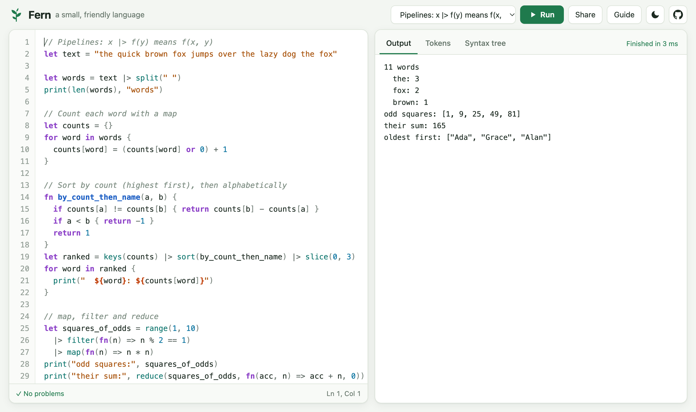
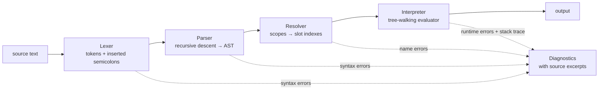

# Fern: a small, friendly programming language

[](https://github.com/pMag11-alt/fern-lang/actions/workflows/ci.yml)


Fern is a dynamically typed scripting language with closures, first-class functions, lists, maps, string
interpolation and a pipeline operator. Its interpreter is written from scratch in TypeScript: a lexer, a
recursive-descent parser, a static resolver and a tree-walking evaluator. It runs in the terminal and in an
in-browser playground.

The project puts error messages first. Fern reports every problem it can find before running anything, points at the
exact code, and suggests a fix:

```text
error: undefined variable 'cuont'
 --> main.fern:2:7
  |
2 | print(cuont)
  |       ^^^^^ did you mean 'count'?
```

**▶ Try it in your browser: https://pmag11-alt.github.io/fern-lang/**



```js
// Closures, pipelines and string interpolation
fn make_counter() {
  let count = 0
  return fn() {
    count += 1
    return count
  }
}

let next = make_counter()
next()
print("called ${next()} times")          // called 2 times

let odd_squares = range(1, 10)
  |> filter(fn(n) => n % 2 == 1)         // x |> f(y) means f(x, y)
  |> map(fn(n) => n * n)
print(odd_squares, sum(odd_squares))     // [1, 9, 25, 49, 81] 165
```

## Features

**The language**
- Numbers, strings, booleans, `nil`, lists and maps, with structural equality (`[1, [2]] == [1, [2]]`)
- `let` and `const` with block scope, closures, recursion, and anonymous functions (`fn(x) => x * 2`)
- `if` / `else if` / `else`, `while`, `for x in list`, `break`, `continue`
- String interpolation (`"total: ${a + b}"`) and a pipeline operator (`xs |> map(f) |> sum`)
- Optional semicolons: a line break ends a statement, as in Go, but you can still split a pipeline across lines
- 50 built-in functions: `map`, `filter`, `reduce`, `sort` (with a key or comparator), `split`, `join`, `slice`,
  `keys`, `range` and more

**The implementation**
- **Error recovery**: the parser skips to the next statement after a mistake, so it reports several errors in one
  pass instead of one per run
- **A static resolver** catches undefined variables (with "did you mean?"), assignments to constants, duplicate
  declarations, use before definition, and misplaced `return` or `break`, all before the program runs
- **Runtime errors with stack traces** point at the failing expression in every active function call
- **A guard against runaway recursion**: deep recursion becomes a Fern "stack overflow" error instead of crashing
  the host
- **A REPL** with multi-line input and persistent variables, plus `--tokens` and `--ast` modes for seeing how the
  compiler stages work

**The playground**
- Syntax highlighting driven by Fern's own lexer, with live red squiggles from the resolver as you type
- Programs run in a Web Worker, so an infinite loop never freezes the page. Stop it with a button or Esc
- Tokens and syntax-tree views of whatever is in the editor
- Share links store the whole program in the URL, with no backend. It also has 10 examples, a language guide, dark mode
  and phone layout

## Quick start

You need Node.js 22 or newer. TypeScript is the only dependency, and only at build time.

```bash
git clone https://github.com/pMag11-alt/fern-lang.git
cd fern-lang
npm install
npm start                       # builds the playground → http://localhost:5174
```

The command-line interpreter:

```bash
npm run build
node dist/cli/fern.js examples/08-mandelbrot.fern   # run a program
node dist/cli/fern.js                               # start the REPL
node dist/cli/fern.js --ast examples/05-fizzbuzz.fern
npm test                                            # 165 tests with the built-in node:test runner
```

```text
$ node dist/cli/fern.js
Fern 1.0.0 REPL. Type .help for help, .exit or Ctrl+D to quit.
fern> fn square(x) => x * x
fern> range(1, 6) |> map(square)
[1, 4, 9, 16, 25]
fern> let scores = {ada: 92, alan: 87}
fern> scores.ada + scores.alan
179
```

Examples, with links that open each one running in the playground:
[closures](https://pmag11-alt.github.io/fern-lang/?example=02-closures.fern&run),
[recursion and memoization](https://pmag11-alt.github.io/fern-lang/?example=03-recursion.fern&run),
[quicksort and binary search](https://pmag11-alt.github.io/fern-lang/?example=06-sorting.fern&run),
[the Sieve of Eratosthenes](https://pmag11-alt.github.io/fern-lang/?example=07-primes.fern&run),
[an ASCII Mandelbrot set](https://pmag11-alt.github.io/fern-lang/?example=08-mandelbrot.fern&run) and
[Conway's Game of Life](https://pmag11-alt.github.io/fern-lang/?example=09-life.fern&run).

## How it works



```
src/
├── lexer.ts         tokens, string interpolation, automatic semicolon insertion
├── parser.ts        recursive descent + precedence climbing, error recovery
├── ast.ts           node types
├── resolver.ts      static scoping, hoisting, name errors, "did you mean?"
├── interpreter.ts   evaluator, closures, calls, runtime errors and stack traces
├── builtins.ts      the 50 built-in functions
├── values.ts        runtime values, printing, equality, truthiness
├── errors.ts        diagnostics and their formatting
└── printer.ts       AST → S-expressions (for the AST view and parser tests)
cli/fern.ts          file runner and REPL
web/                 playground: editor, highlighter, Web Worker runner, share links
```

### Design decisions

**Semicolons are inserted by the lexer, Go-style.** At a line break, the lexer adds a `;` if the line ends with a
token that can end a statement: a name, a literal, `)`, `]`, `}`, `return` and so on. Unlike Go, it never does this
inside `(` or `[`, and it skips it when the next line starts with `|>`, `.`, `else`, `and` or `or`, so pipelines can
span lines. It also recovers when a bracket is never closed. A statement keyword such as `let` can't appear
directly inside `[...]`, so seeing one ends the statement. Without that, one missing `]` would swallow every line
break in the file.

**Interpolation is parsed in place.** For `"a ${x + 1} b"`, the lexer records only the source *range* of
`x + 1`. The parser then runs a second lexer limited to that range of the same file, so every token inside the
interpolation keeps its true position, and errors inside `${...}` are underlined exactly.

**Variables are resolved before running.** The resolver walks the AST once with a stack of scopes and records, for
every variable use, how many scopes up it lives and at which slot. At runtime, a scope is a plain array, and reading a
variable means following `depth` parent links and indexing `slot`, with no string lookups. The same pass hoists
declarations to the top of their block, so functions can be mutually recursive. It also finds use-before-definition
statically when that is certain, which is within the same function. When it is only possible, through a closure,
the check happens at runtime.

**Control flow without exceptions.** `break`, `continue` and `return` don't throw. Each statement returns a
completion value (normal, break, continue or a return value) that loops and calls inspect. Exceptions are reserved for
runtime errors, and those collect stack frames as they unwind through `callClosure`.

**Every loop iteration gets a fresh scope**, so closures created in a loop capture their own iteration's variable.
This avoids a classic JavaScript `var` bug, and a test checks it.

**Semantics chosen to be unsurprising:** only `false` and `nil` are falsy (as in Lua and Ruby). `%` is floored, so
`-7 % 3` is `2`, as in Python. `==` compares lists and maps by value. `"a" + 1` is an error with a hint to use
interpolation, and division by zero is an error rather than `Infinity`.

**The playground runs code in a module Web Worker.** Stopping a runaway program means terminating the worker.
Printed lines are batched, and the interpreter calls a heartbeat every 1,024 loop iterations so the worker can flush
output while a long computation is still running.

## Testing

The 165 tests use Node's built-in `node:test` runner:

- **Lexer**: numbers, escapes, interpolation ranges, every semicolon-insertion rule, error recovery, exact spans
- **Parser**: precedence and associativity tables, pipeline desugaring, literals, multi-line input and recovery from
  several errors at once
- **Resolver**: suggestions, constants, duplicates, use before definition, hoisting and mutual recursion, misplaced
  `return`, `break` and `continue`
- **Interpreter**: operators, closures, per-iteration scopes, nested returns, the REPL session, and every runtime error
  message and hint, plus stack traces and recursion limits
- **Built-ins**: all 50 functions, including their error messages
- **Examples**: golden-output tests that run every program in `examples/` and compare it with its `.out` file
- **Playground**: HTML escaping in the highlighter, diagnostic underlines and share-link round-trips

CI runs the tests on Node 22 and 24, runs every example through the CLI, then builds the playground and deploys it to
GitHub Pages.

## Limitations and ideas for extension

- A bytecode compiler and VM in place of tree-walking, for a 5–10× speedup
- Classes or records with methods, and destructuring (`let [a, b] = pair`)
- `try` / `catch` for user code, and a module system
- An LSP server, which would reuse the resolver for go-to-definition and the diagnostics for squiggles in any editor

## License

[MIT](LICENSE)
